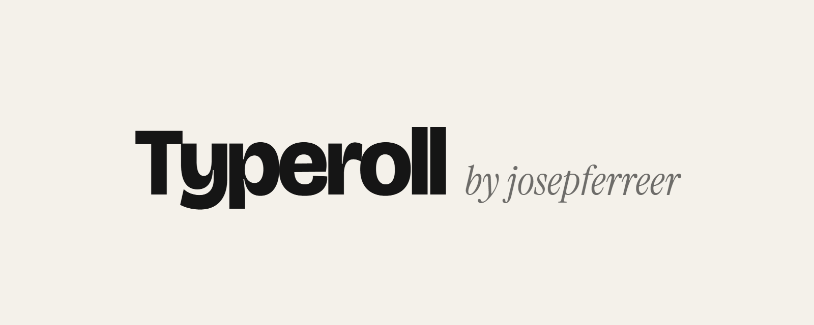

  

  Tienes cientos de fuentes instaladas y siempre acabas usando las mismas. 
  <strong>Typeroll</strong> las mezcla por ti para que descubras combinaciones nuevas.

---

## Qué es

Typeroll es una pequeña herramienta para diseñadores. Lee las fuentes que tienes instaladas en tu ordenador y te las enseña emparejadas al azar: un título con un subtítulo, o tantas como quieras combinar.

Le das a **Randomizar**, miras, y cuando una te convence la fijas. A partir de ahí solo cambian las demás, hasta que encuentras la pareja que buscabas.

## Cómo empezar

1. Descarga el archivo `index.html`.
2. Ábrelo con **Google Chrome** o **Microsoft Edge**.
3. Pulsa **Cargar mis fuentes** y acepta el permiso que te pide el navegador.

No hay que instalar nada ni crear ninguna cuenta. Tus fuentes no salen de tu ordenador.

## Cómo se usa

**Randomizar.** Pulsa el botón o la barra espaciadora y cada línea cambia de fuente.

**Fijar la que te gusta.** Haz clic en el candado de una fuente (o pulsa su número en el teclado). La siguiente vez solo cambiarán las que no estén fijadas.

**Cuántas fuentes.** Empieza con dos, pero puedes subir hasta ocho con los botones − y +.

**Colores.** Elige el color de fondo y el del texto, inviértelos con un clic o da a cada fuente su propio color.

**Escribe tu propio texto.** Haz clic sobre cualquier frase y cámbiala por la tuya: el nombre de una marca, un titular, lo que estés diseñando.

**Ajusta cada fuente.** Cambia el tamaño, elige otro estilo de la misma familia (light, bold, cursiva…) o randomiza solo esa línea con el dado.

## Para no perderte entre tantas fuentes

**Biblioteca.** Todas tus fuentes en una lista, cada una escrita con su propio estilo. Búscalas por nombre y haz clic para probarlas al momento.

**Descartar.** ¿Hay fuentes que no quieres volver a ver? Descártalas y desaparecen de la ruleta. Si cambias de idea, las recuperas desde la pestaña *Descartadas*.

**Guardar combinaciones.** Cuando encuentres una pareja que te guste, guárdala. Quedan todas en la pestaña *Guardadas* para volver a ellas cuando quieras.

**Copiar.** Copia los nombres de las fuentes, sus tamaños y los colores para pegarlos en Figma, Illustrator o donde trabajes.

**Volver atrás.** ¿Te has pasado una combinación que te gustaba? Pulsa *Anterior* o `Ctrl + Z`.

Typeroll recuerda tus textos, colores y combinaciones guardadas la próxima vez que lo abras.

## Atajos de teclado

| Tecla | Qué hace |
| --- | --- |
| `Espacio` | Randomizar |
| `1` … `8` | Fijar o soltar esa fuente |
| `Ctrl + Z` | Volver a la combinación anterior |
| `Esc` | Cerrar la biblioteca |

## Navegadores

Typeroll funciona en **Chrome** y **Edge** de escritorio, que son los que permiten leer las fuentes instaladas.

En Firefox o Safari no pueden leerse, así que solo detecta una lista de fuentes conocidas que suelen venir con el sistema o que son muy populares.

---

Hecho por <strong>josepferreer</strong>

